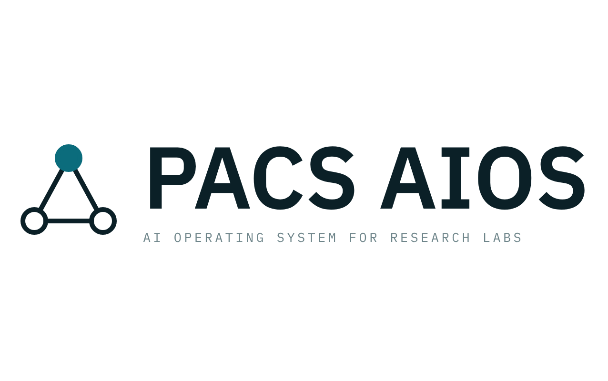
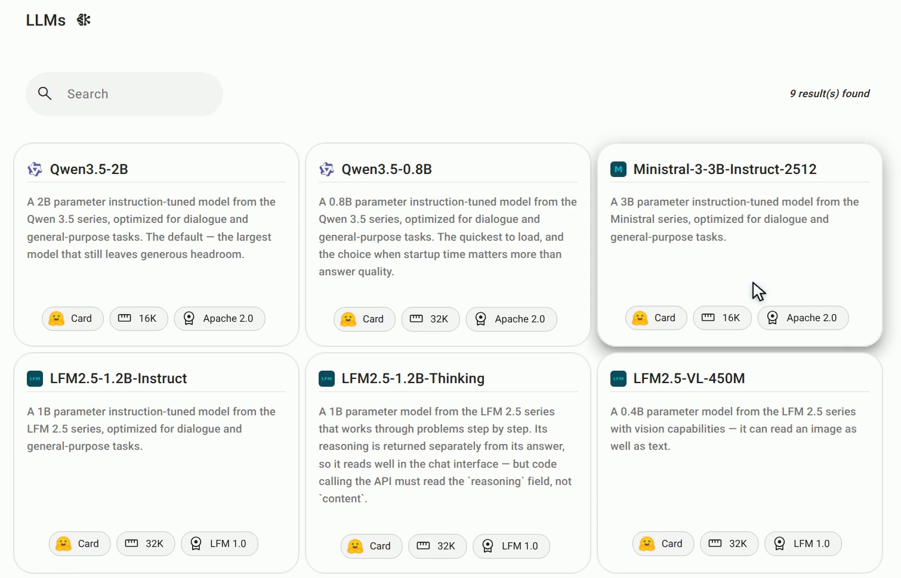
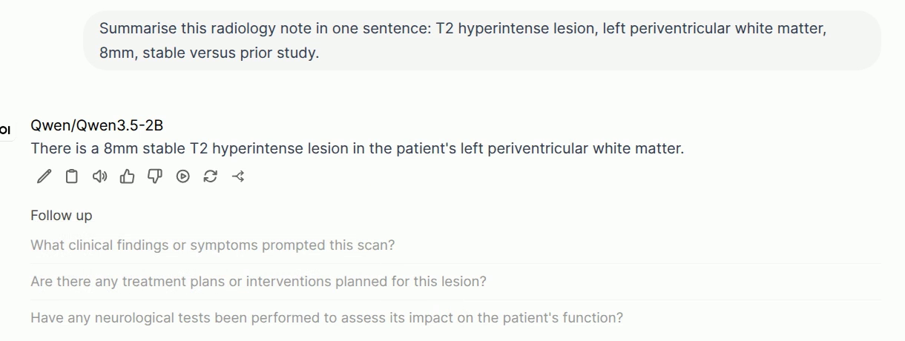
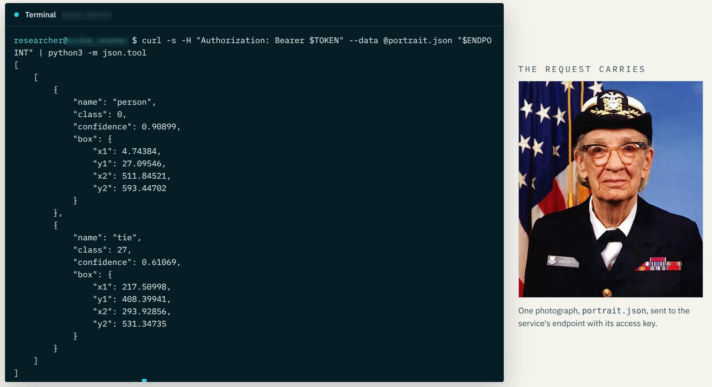
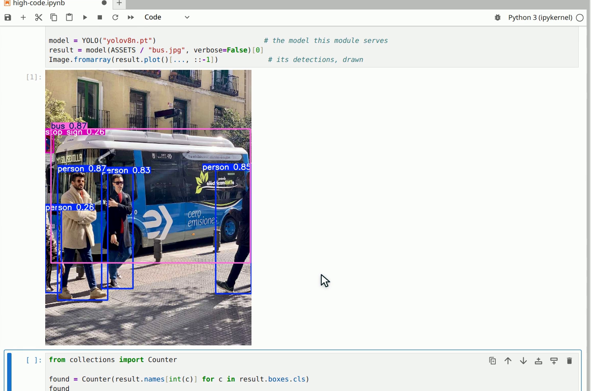
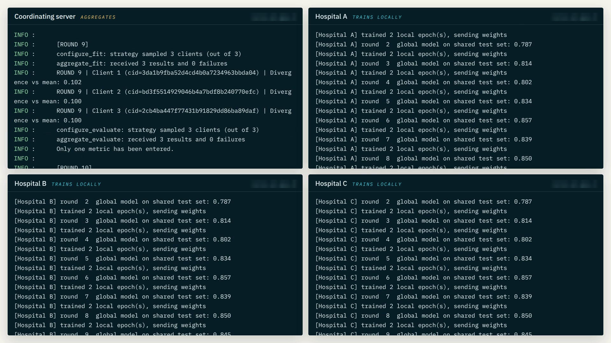
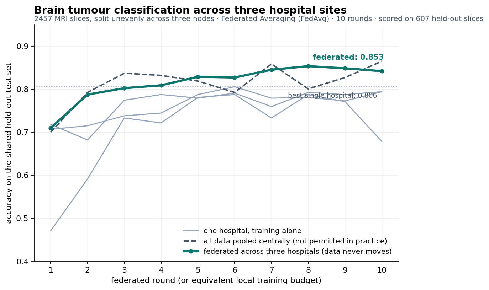

  <picture>
    <source media="(prefers-color-scheme: dark)" srcset="docs/assets/paios-logo-dark.png">
    
  </picture>

  <strong>A research prototype from the PACS Lab at York University: private language models, 
  model endpoints, JupyterLab and federated learning on a seven-node GPU cluster.</strong>

Researchers shouldn't need a platform team just to do AI research. In an academic lab,
GPUs, drivers, orchestration, sign-in and secure environments all have to be sorted out
before the first model trains. PACS AIOS is a prototype that takes that work off the
researcher's hands, built for medical and neuroscience research. It runs on Digital
Research Alliance of Canada infrastructure and builds on the open-source
[AI4OS](https://docs.ai4os.eu/) stack.

> [!NOTE]
> PACS AIOS is an early-stage research prototype, not a public service. This repository
> presents the demo and the engineering behind it. The source code is private to the
> PACS Lab, and nothing here is offered under an open-source licence.

My work focused on platform engineering with Nomad and Ansible, LLM serving, and
federated learning.

## The demo

A four-minute narrated walkthrough, recorded on the live prototype: a new researcher
signing up, the three ways of working described below, and federated training across the
three hospital sites.

https://github.com/user-attachments/assets/c2df3109-b703-4f08-9ab3-5430213978d1

  <a href="https://github.com/AlirezaAbedinii/pacs-aios/releases/download/demo-2026-09/pacs-aios-demo-captioned.mp4">Download in 1080p</a> (MP4, 4:02, captioned)
  · <a href="docs/demo-transcript.md">Chapters and transcript</a>

The stills below come from the same recording.

### No code: a private language model on the lab's GPU

Pick an open model from the catalogue, fill in a short form, and minutes later it is
answering at its own private address. There is nothing to install and no driver to set up,
and prompts never reach a commercial AI service.

### Low code: a model endpoint

The same object-detection model, published as a serverless endpoint that runs only when a
request arrives. One `curl` sends a photograph and gets back JSON.

### High code: the same model in JupyterLab

The model opened as a workspace with its own code and environment: detections drawn
inline, then the serverless endpoint and the private language model called from the same
notebook.

### Federated learning across three simulated hospital sites

One model trained across three machines, each holding its own patients' scans. Each site
trains locally and sends only model updates; a coordinating server combines them. No scan
leaves its site.

## Results, measured on the cluster

**Federated learning.** Brain-tumour MRI classification: 2,457 slices split unevenly
across three hospital nodes, 10 rounds of Federated Averaging (Flower), scored on 607
held-out slices.

| Setting | Accuracy |
|---|---|
| Best single hospital, training alone | 0.806 |
| **Federated across the three sites, no data moved** | **0.853** |
| All data pooled centrally (not permitted in practice) | 0.865 |

**Under load.** 10 federated rounds ran in 34.6 s while the private language model kept
answering at 71–81 ms. Neither slowed the other.

**Readiness.** The dashboard used to call a language-model deployment ready about three
minutes before its chat interface existed. Each fix closed one gap, and the arc ran
184 s → 22 s → 3 s → 0 ([field note 15](docs/field-notes.md#15-ready-needs-three-signals)).

**Curation.** The upstream catalogue held 46 modules, two of them medical. The prototype
offers 9 modules, 12 bioimage.io models defaulting to connectomics, and 9 open language
models sized for a 10 GB GPU slice.

## How it works

  <picture>
    <source media="(prefers-color-scheme: dark)" srcset="docs/assets/architecture-dark.png">
    
  </picture>

- **Nomad, not Kubernetes.** Every deployment is a Nomad job rendered by PAPI, the
  platform API. PAPI is the only component holding cluster credentials; the dashboard
  talks only to PAPI.
- **Seven VMs.** A control plane, an ingress node, three hospital sites and an LLM node,
  each with a MIG slice of an NVIDIA H100, plus a 16-core K3s node for serverless
  inference.
- **Every deployment gets its own subdomain**, routed by Traefik from Consul's catalogue,
  behind a public TLS proxy.
- **Upstream, not a fork.** Every change to AI4OS is configuration or a numbered patch,
  applied to pinned upstream sources.

The [architecture notes](docs/architecture.md) go further: what runs on each node, how a
deployment goes from a form to a working address, and how the federated and LLM
deployments are put together.

## Engineering highlights

| Area | What was built |
|---|---|
| **Infrastructure as code** | Ansible playbooks for Consul, Nomad, Traefik, the NVIDIA device plugin, XFS data volumes and image pinning; a Docker Compose control plane with Keycloak, Vault, PAPI, the dashboard, Caddy and an approval service. |
| **Working with upstream** | 42 numbered patches across three AI4OS repositories, applied to pinned commits, each recording why it could not be configuration. |
| **GPUs** | Found that every GPU job had run on a device CUDA could not address, behind a healthy `nvidia-smi`. Fixed it with a device-plugin upgrade and a regression test that multiplies two matrices ([field note 9](docs/field-notes.md#9-nvidia-smi-is-not-evidence-that-a-gpu-works)). |
| **LLM serving** | vLLM and Open WebUI on a 10.3 GB MIG slice, with health checks, readiness gating, and a model catalogue served from the cluster itself. |
| **Federated learning** | A Flower server and per-site clients, a non-IID split by patient, site-alone and pooled baselines, and per-site bundles that hold only that site's data. |
| **Identity and access** | A Keycloak realm, self-registration with administrator approval, and least privilege for the approval service. |
| **Serverless** | OSCAR on K3s wired to the platform's identity, with readable errors and results returned as JSON. |
| **Testing** | 361 offline unit tests that render the Nomad job templates and check the patches, configuration and pages; smoke tests against the live cluster; secret scanning on every push. |
| **Records** | 87 design decisions with the alternatives rejected, a runbook, and the field notes below. |

**Stack:** Nomad · Consul · Traefik · Ansible · Docker Compose · Keycloak · Vault ·
FastAPI · Angular · vLLM · Open WebUI · Flower · PyTorch · OSCAR on K3s · OpenStack ·
NVIDIA H100 (MIG)

## Field notes

[docs/field-notes.md](docs/field-notes.md) collects 38 problems that each cost real time,
most of them a system reporting success while doing nothing. Three examples:

- A GPU that `nvidia-smi` shows, but that CUDA cannot address.
- A chat interface that serves an empty model list with HTTP 200, because it swallows a
  TLS error.
- A `cmd | grep -q` that reports failure precisely when the pattern is found.

## Credits

Built at the [PACS Lab](https://pacs.eecs.yorku.ca/), York University, under the
supervision of Dr. Hamzeh Khazaei, with Arian Boukani. The prototype builds on
[AI4OS](https://github.com/ai4os) by the AI4EOSC project and runs on Digital Research
Alliance of Canada infrastructure.
