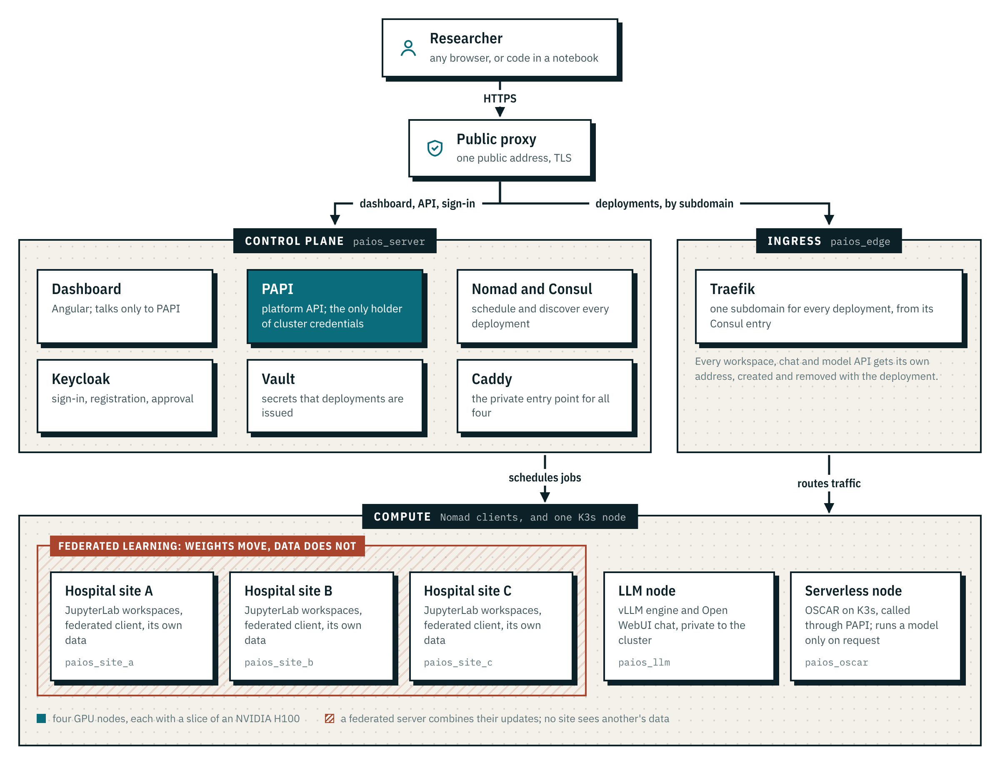

# Architecture

How the PACS AIOS prototype is put together. It is a deployment of the open-source
[AI4OS](https://docs.ai4os.eu/) stack, extended by configuration and a set of patches,
on seven OpenStack VMs on Digital Research Alliance of Canada infrastructure.

  <picture>
    <source media="(prefers-color-scheme: dark)" srcset="assets/architecture-dark.png">
    
  </picture>

## The nodes

| Node | Role | What runs there | Hardware |
|---|---|---|---|
| Control plane | The brain and the web services | Consul and Nomad servers; Keycloak, Vault, PAPI, the dashboard and Caddy under Docker Compose; the Ansible control node | 3 vCPU, 34 GB, H100 MIG slice |
| Ingress | The way into every deployment | Traefik as a Nomad job, plus a Nomad CPU client | 3 vCPU, 34 GB, H100 MIG slice |
| Hospital site A, B, C | Workspaces and federated clients | Nomad GPU clients; each holds only its own site's data | 3 vCPU, 34 GB, H100 MIG slice each |
| LLM node | Private language models | A Nomad GPU client reserved for the LLM tool | 3 vCPU, 34 GB, H100 MIG slice |
| Serverless node | Models that run on request | OSCAR on K3s with MinIO; deliberately outside Nomad | 16 vCPU, 58 GB, no GPU |

Each GPU is a MIG slice of an H100 (`1g.12gb`). It reports 12 GB, of which 10.3 GB is
usable once ECC and vGPU overhead are taken; everything that sizes itself against the GPU
is sized against 10.3 GB.

Only the public proxy has a public address. Every node sits on a private network, and
the team reaches the nodes through a VPN and a jump host.

## From a form to a working address

1. A researcher fills in a form in the **dashboard** (Angular), signed in through
   **Keycloak** (OIDC).
2. The dashboard sends it to **PAPI** (FastAPI), the only component holding Nomad
   credentials. PAPI checks the user's access level and quotas, and renders a Nomad job
   from a template.
3. **Nomad** places the job. Every template requires four things of a node: the right
   status, type and namespace in its metadata, and the right region. The scheduler runs in
   `spread` mode, so the three hospital workspaces land on three different machines.
4. The job registers its services in **Consul**. **Traefik** reads Consul's catalogue and
   gives the deployment its own subdomain, under a wildcard certificate.
5. PAPI reports the deployment as running only once a user could actually open it: its
   health checks pass, and it has stayed healthy long enough for Traefik's next poll of
   Consul. Before that it says "starting", and a deployment queued for capacity says
   which resource ran out.

A public **nginx** proxy terminates TLS for the outside world and routes by hostname:
the dashboard, API and sign-in go to **Caddy** on the control plane, and deployments go
to **Traefik** on the ingress node.

## The federated-learning demo

- A **Flower** server runs as a deployment with its own TLS route for gRPC. Deploying it
  also creates a secret and a token in **Vault**, which trusts the platform's Keycloak.
- Each "hospital" is a JupyterLab workspace on its own node. It fetches a bundle holding
  only that site's share of the data, plus the platform's CA, so it verifies TLS rather
  than skipping it.
- The data is a public brain-tumour MRI set, split by patient and deliberately unevenly
  (non-IID) across the three sites, with a shared held-out test set.
- Only model weights, a sample count and an accuracy leave a site. Site-alone and pooled
  baselines are trained with the same model definition, so the comparison is like for
  like.
- The public proxy cannot carry gRPC, so the clients reach the server through the ingress
  node directly.

## The language-model deployment

- **vLLM** serves the model and **Open WebUI** gives it a chat window, as two tasks in
  one Nomad group on the LLM node.
- Open WebUI reaches vLLM at its address inside the allocation, never through the
  deployment's public name. Its administrator account is created as the container starts,
  before the port opens, so nobody can claim it first.
- The catalogue of nine models, and the badges on its cards, are served by the cluster
  itself. The visitor's browser makes no request to a third-party host.

## Identity and access

- One **Keycloak** realm for the platform. Access is a realm role per virtual
  organisation and level, which PAPI reads from the token.
- New users register themselves. A pending account is simply one without an access role,
  so approving is a single role assignment, done from an admin page in the dashboard.
- The approval service can view and manage users and nothing more, so it can never grant
  more than it is approving.
- OSCAR reads group membership rather than roles, so approval also adds the user to its
  group.

## Working with upstream

AI4OS is used as it is published, at pinned commits. Every change is either configuration
or one of 42 numbered patches (23 to PAPI, 18 to the dashboard, 1 to the cluster tests),
each recording why configuration could not do it. Rebuilding from a newer upstream means
re-applying the patches and running the tests.

## Testing and operations

- **361 offline unit tests** render the Nomad job templates and check them, along with the
  patches, the configuration and the dashboard pages. They run in seconds, on every push.
- **Smoke tests** run against the live cluster: GPU scheduling (a matrix multiply, not
  `nvidia-smi`), LLM deployment and chat, registration end to end, the federated path,
  and every catalogue module.
- **Secret scanning** runs on every push.
- **87 design decisions** are recorded with the alternatives that were rejected, and the
  problems that cost real time are in the [field notes](field-notes.md).
